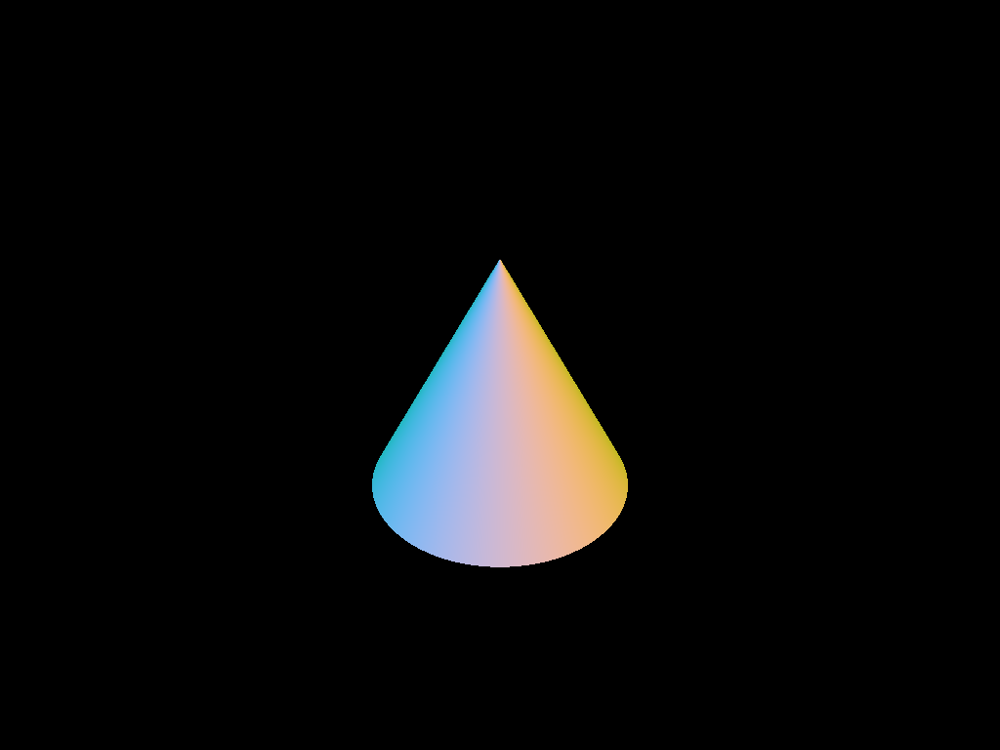
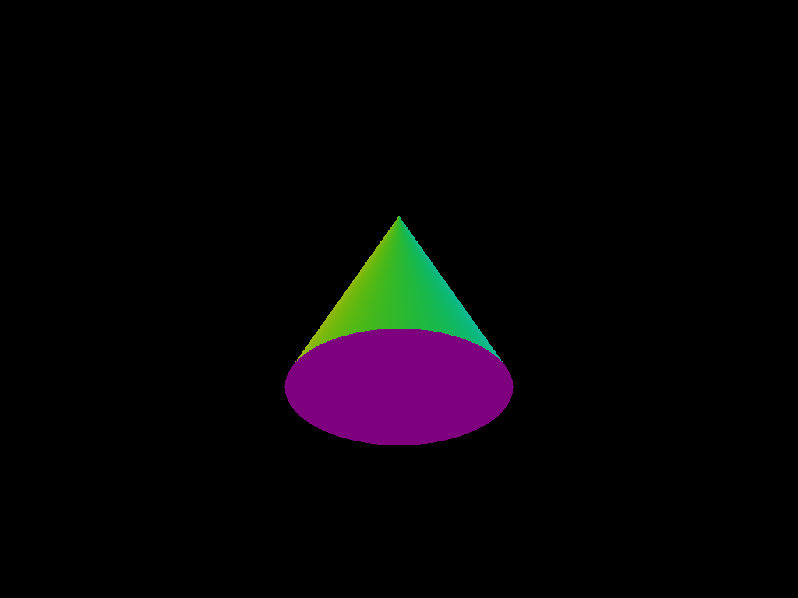
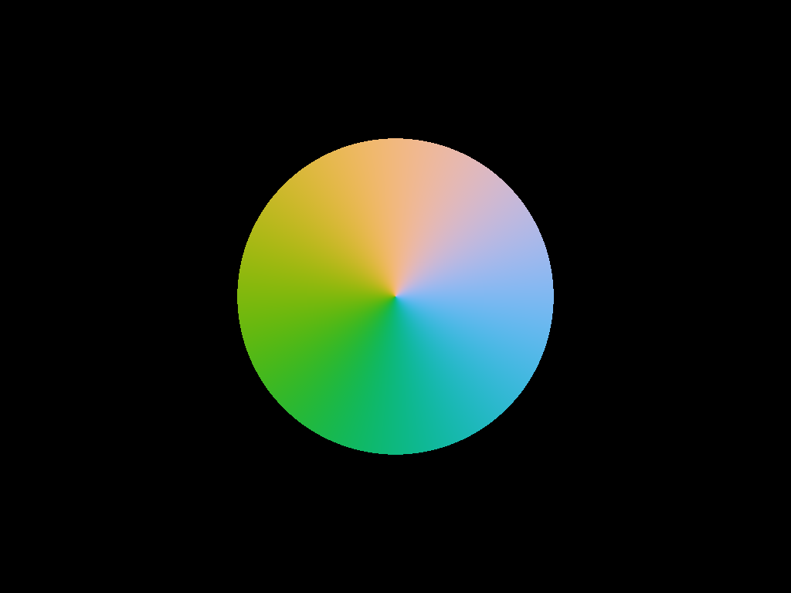
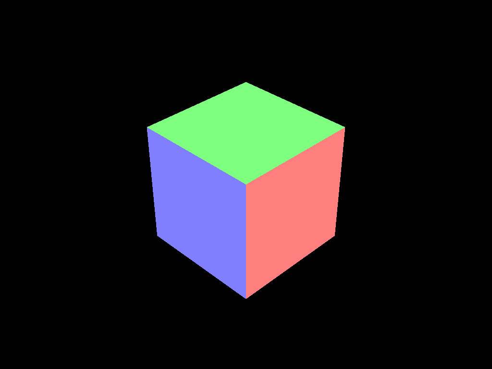
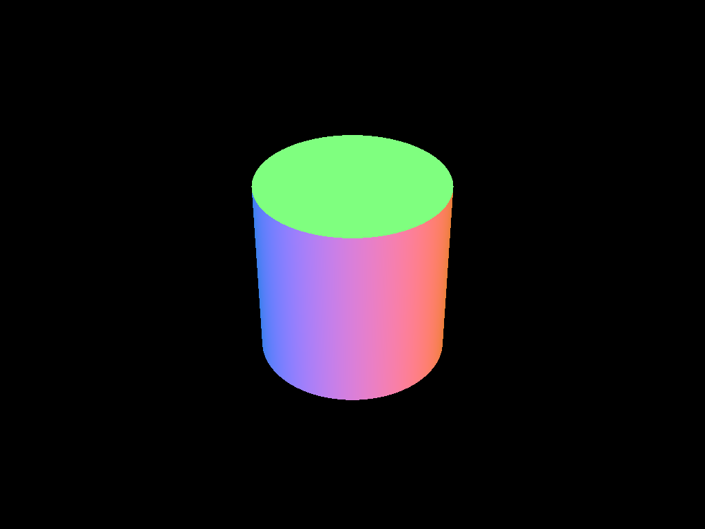
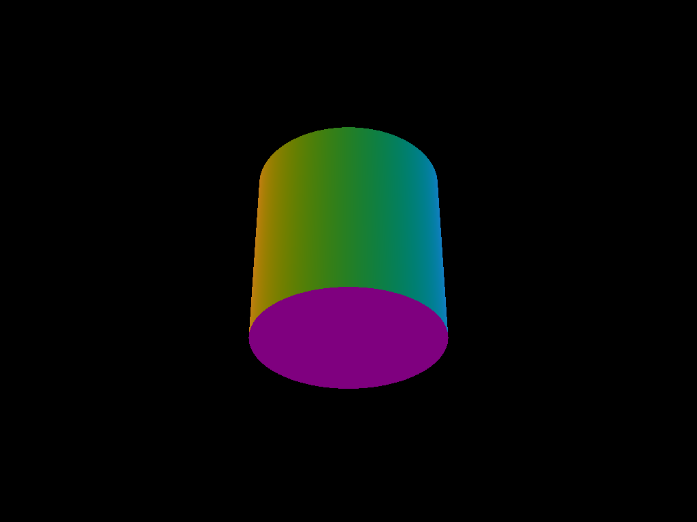
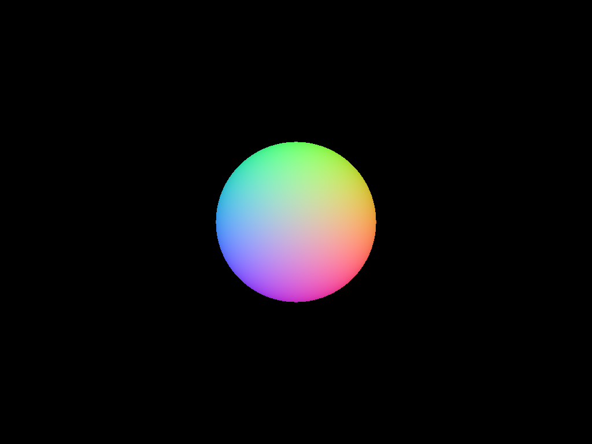
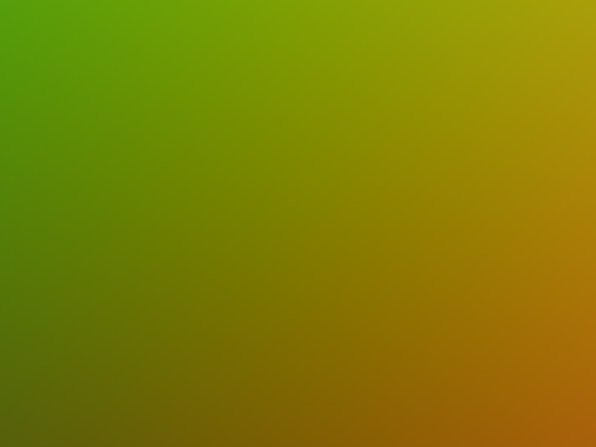
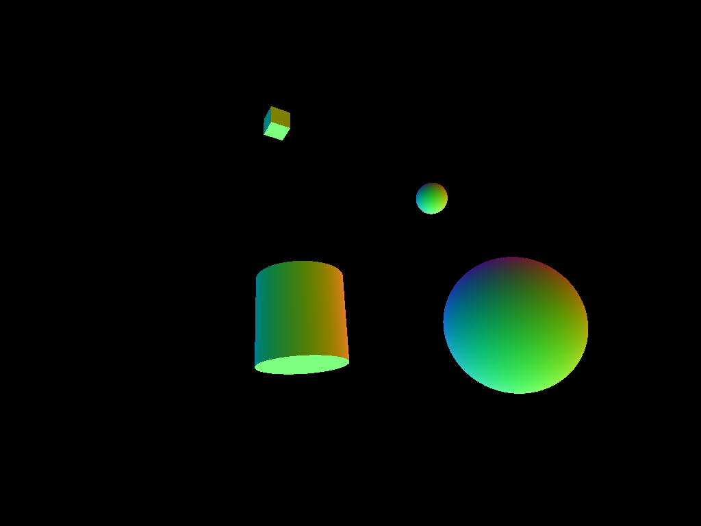
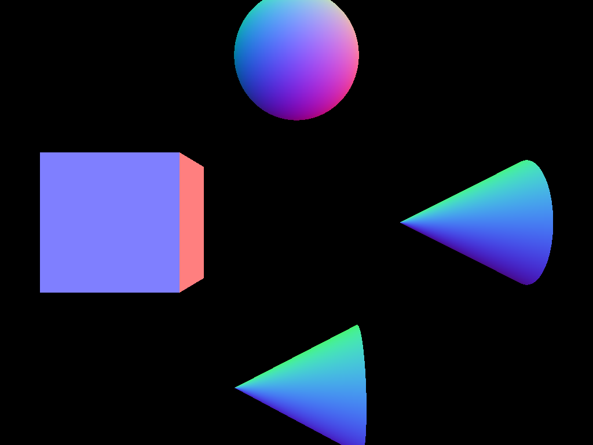

## Project 2: Intersect

Please fill this out for Intersect only. The project handout can be found [here](https://cs1230.graphics/projects/ray/1).

### Output Comparison

Run the program with the specified `.ini` file to compare your output (it should automatically save to the correct path).

> If your program can't find certain files or you aren't seeing your output images appear, make sure to: 
>
> 1. Set your working directory to the project directory
> 2. Set the command-line argument in Qt Creator to `template_inis/intersect/<ini_file_name>.ini`
> 3. Clone the `scenefiles` submodule. If you forgot to do this when initially cloning this repository, run `git submodule update --init --recursive` in the project directory

> Note: once all images are filled in, the images will be the same size in the expected and student outputs.

| File/Method To Produce Output |                                                           Expected Output                                                            |                                                             Your Output                                                              |
| :---------------------------: | :----------------------------------------------------------------------------------------------------------------------------------: | :----------------------------------------------------------------------------------------------------------------------------------: |
|         unit_cone.ini         |             |                 |
|       unit_cone_cap.ini       |         |         |
|       unit_cone_top.ini       |         |         |
|         unit_cube.ini         |             |                 |
|       unit_cylinder.ini       |         |         |
|   unit_cylinder_bottom.ini    |  |  |
|        unit_sphere.ini        |           |             |
|        unit_sphere_inside.ini        |           |             |
|       parse_matrix.ini        |          |           |
|           normal_total.ini           |          |                  |

### Design Choices
In terms of editting stencil code, I only added inverse_ctm to the RenderShapeData struct to add an inverse_ctm variable. I did this so that the inverse was calculated one time and then kept in memory to be accessed later. Assigning this inverse was also the only change I made to my Lab 3 parser code, which I directed copied and pasted from the lab.

I decided to keep ray generation logic in camera, and have the generateRay method generate a ray as a struct of data (containing origin and direction). Originally I had a large switch statement in my rayTracer that had all shape logic, realizing this was suboptimal design, I created a parent shape class, that has each of the primitive shapes as a child class. After this change, the rayTracer was solely in charge of assigning color to each pixel by looping through each shape on a givel ray and calling the Shape class's intersect method. I also decided to create a Hit struct to store the shape, t, and normal value.

### Collaboration/References
Used AI for general C++ help and to understand high-level concepts.

### Known Bugs
N/A

### Extra Credit
N/A
